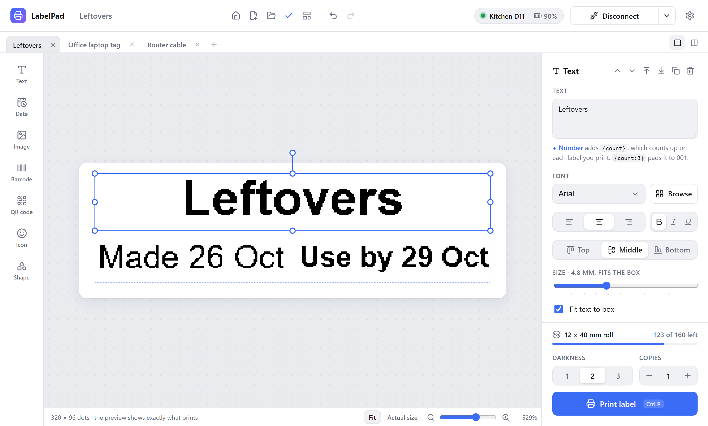

# LabelPad

A modern desktop app for designing and printing labels on **Niimbot D11 and M3** Bluetooth label printers. Runs on Windows, macOS and Linux.

**[Website and guide](https://derhally.github.io/labelpad/)** · **[Download](https://github.com/derhally/labelpad/releases/latest)**



Built with [Tauri 2](https://tauri.app): a React + TypeScript label editor in the system webview, and a Rust backend that talks to the printer over Bluetooth LE ([btleplug](https://github.com/deviceplug/btleplug)). The Niimbot protocol in `src-tauri/printer` is a Rust port of [niimbluelib](https://github.com/MultiMote/niimbluelib), tested byte for byte against it.

## Getting started

Requires Node.js 22+, [Rust](https://rustup.rs) (stable), and the [Tauri prerequisites](https://tauri.app/start/prerequisites/) for your OS. On Windows that's the MSVC build tools and WebView2, which Windows 10/11 already include.

```bash
npm install
npm run dev
```

Turn on the printer, click **Connect printer**, and pick it from the list. You don't need to pair it in your system's Bluetooth settings first.

## How it's built

| Path | What it is |
| --- | --- |
| `src/renderer` | React UI: the label editor and its 1-bit renderer |
| `src-tauri/src` | Tauri app: commands the UI calls (`scan_start`, `printer_connect`, `printer_print`, …) and the `--mcp` bridge for AI agents |
| `src-tauri/printer` | Printer protocol: packets, image encoding, print jobs and the Bluetooth transport |
| `scripts/gen-protocol.cjs` | Regenerates the printer model table and the reference test fixtures from niimbluelib |

## Designing labels

Add text, dates, images, barcodes, QR codes, icons and shapes from the left toolbar, then drag, resize and rotate them on the label. Everything snaps to the label edges, its center and other elements. The preview is the exact 1-bit image that's sent to the printer.

- **Text** can use any font installed on your computer, aligned left, center or right and top, middle or bottom. "Browse" shows every font with your label's text, filtered by style (sans serif, serif, monospace, handwriting, display).
- **Date** prints the date and/or time when the label is printed: date + time, date only, or time only. Dates use a format you pick (or your own pattern such as `DD/MM/YYYY`), and times are 12- or 24-hour. "Add days" makes use-by labels.
- **Files**: labels save as `.labelpad` files (JSON). The label you were working on reopens when the app starts; turn that off in Settings.
- **Templates**: New (Ctrl+N) offers a blank label, built-in templates, and any label you saved with "Save as template". Templates live in the app's data folder.
- **Align and distribute**: with several items selected, line up their edges or centers with each other or with the label, or space them evenly. A single item can be aligned to the label from its panel.
- **Numbered labels**: put `{count}` in text, a barcode or a QR code (`{count:3}` pads to 001). Printing 3 copies gives 1, 2, 3; the print panel sets the start number and step, and the next print carries on. The counter is saved with the label.
- **Label rolls**: genuine Niimbot rolls carry an RFID tag. When connected, the app shows how many labels are left and uses the roll's label type. The tag doesn't include the size, so the first time a roll type is loaded the app asks for its size and remembers it; after that it offers to switch your label to that size.
- **Updates**: once a week the app checks GitHub releases for a newer version and asks before installing it (Settings has "Check now" and an off switch). Windows, macOS and the Linux AppImage update in place; .deb and .rpm installs get a link to the new package. Release builds are signed with the key in the `TAURI_SIGNING_PRIVATE_KEY` secret, and the app checks them against the public key in `tauri.conf.json`.
- **Settings** (gear icon): light, dark or system theme. Darkness, copies, label size and the last printer are remembered.

| Shortcut | Action |
| --- | --- |
| Ctrl+N | New label from a template |
| Ctrl+O | Open a label |
| Ctrl+S / Ctrl+Shift+S | Save / save as |
| Ctrl+Z / Ctrl+Shift+Z | Undo / redo |
| Shift-click, or drag on an empty spot | Select several items |
| Ctrl+A | Select everything |
| Ctrl+D | Duplicate |
| Delete | Remove |
| Arrow keys | Nudge 1 dot (Shift: 1 mm) |
| Ctrl+P | Print |
| Esc | Deselect |

### Linux

Bluetooth needs BlueZ, and your user must be allowed to use it (usually by being in the `bluetooth` group). Building needs `libwebkit2gtk-4.1-dev` and `libdbus-1-dev`.

## AI agents (MCP)

LabelPad is also an [MCP](https://modelcontextprotocol.io) server, so an AI agent such as Claude can connect a printer, design a label and print it the way you would. The agent works in the open LabelPad window: you see each change as it's made and can undo it. If LabelPad isn't running, the agent starts it.

Add it to your agent's MCP settings with the path to the LabelPad executable and the `--mcp` argument. On Windows the installer puts it in `%LOCALAPPDATA%\LabelPad\labelpad.exe`. For Claude Desktop (`claude_desktop_config.json`):

```json
{
  "mcpServers": {
    "labelpad": {
      "command": "C:\\Users\\you\\AppData\\Local\\LabelPad\\labelpad.exe",
      "args": ["--mcp"]
    }
  }
}
```

On macOS the command is `/Applications/LabelPad.app/Contents/MacOS/labelpad`. For Claude Code: `claude mcp add labelpad -- "<path to labelpad>" --mcp`.

| Tool | What it does |
| --- | --- |
| `get_status` | Printer connection, battery, loaded roll and the open labels |
| `scan_printers`, `connect_printer`, `disconnect_printer` | Find and connect a printer; with no name, reconnect the last one |
| `new_label`, `open_label`, `save_label`, `select_label`, `close_label` | Start a label (blank or from a template), open, save and close `.labelpad` files |
| `get_label`, `set_label` | Read the label, change its size, printer or numbering |
| `add_element`, `update_element`, `remove_elements`, `arrange_element`, `undo` | Text, dates, images, barcodes, QR codes, icons and shapes, in millimeters |
| `preview_label` | The exact 1-bit image that will print, so the agent can check its work |
| `print_label` | Print and wait until it's done |
| `list_templates`, `list_icons`, `list_fonts` | What's available |

`labelpad --mcp` speaks MCP over stdio and passes each message to the running app over a local socket (a named pipe on Windows). The tools are in `src/renderer/src/mcp`, and run on the same editor, renderer and printer code as the window.

## Scripts

| Command | What it does |
| --- | --- |
| `npm run dev` | Start the app with hot reload |
| `npm run build` | Build an installer for this OS |
| `npm test` | Run the Rust protocol tests |
| `npm run typecheck` | Type-check the UI |

## Releases

Commit messages follow [Conventional Commits](https://www.conventionalcommits.org) (`feat:`, `fix:`, `docs:`…). [release-please](https://github.com/googleapis/release-please) keeps a release pull request open with the next version and changelog. Merging it tags the release, and the Release workflow builds installers for Windows (.exe, .msi), macOS (Apple silicon .dmg) and Linux (.AppImage, .deb, .rpm) and attaches them to it. The version lives in `package.json`; `tauri.conf.json` reads it from there and release-please updates `Cargo.toml`.

The website in `docs/` is plain HTML and deploys to GitHub Pages on every push to main. To refresh its screenshots, run the app's web UI (`npm run dev:web`) and capture at 1360×820.

## Roadmap

1. Connect over Bluetooth and print a test label
2. Label editor: text, images, barcodes, QR codes and icons
3. Save and open labels, templates, date/time, settings, light and dark themes
4. Installers, automatic releases and the website
